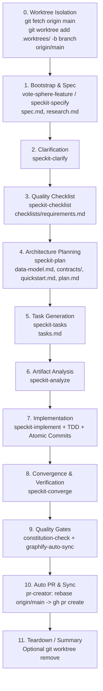

# SpecKit End-to-End Workflow Orchestrator

This skill orchestrates the entire Spec-Driven Development (SDD) lifecycle for Electa inside an **isolated git worktree** rooted at the **latest `origin/main`**, systematically progressing through requirements, architecture, tasks, test-driven implementation, constitutional compliance, and **automated Pull Request (auto PR)** creation via `pr-creator`.

---

## Workflow Phases & Complete 8-Artifact Deliverable Matrix



---

## 📁 The 8 Canonical SpecKit Artifacts (Mandatory Gate)

Every feature in `specs/<feature>/` MUST produce all 8 artifacts:

1. `spec.md` — User stories, Gherkin acceptance criteria, invariants
2. `research.md` — Stack constraints, technology decisions, rationale
3. `data-model.md` — Entity models, DTOs, storage schemas, state machines
4. `contracts/` — Component and API route validation contracts (Zod)
5. `checklists/requirements.md` — Requirements quality validation ("Unit tests for English")
6. `plan.md` — Technical implementation plan and boundary mapping
7. `quickstart.md` — Verification run guide, walkthrough scenarios
8. `tasks.md` — Actionable implementation tasks ordered by dependency

---

## Phase-by-Phase Execution Guide

### Phase 0: Worktree Isolation & Latest `main` Synchronization
1. **Always fetch latest `origin/main` first**:
   ```bash
   git fetch origin main
   ```
2. **Derive branch name**:
   - Conforming to `pr-creator`: `feature/<JIRA-KEY>-<kebab-case-slug>` (e.g., `feature/VS-105-realtime-tally-bar`) or `feature/<kebab-case-slug>`.
3. **Spawn isolated worktree directly from latest `origin/main`**:
   ```bash
   git worktree add .worktrees/<feature-slug> -b <branch-name> origin/main
   ```
   *(If branch already exists, add worktree and rebase onto `origin/main`: `git worktree add .worktrees/<feature-slug> <branch-name> && cd .worktrees/<feature-slug> && git fetch origin main && git rebase origin/main`)*
4. **Bootstrap dependencies & environment**:
   - Link `node_modules` (PowerShell junction or Unix symlink):
     - Windows: `New-Item -ItemType Junction -Path ".worktrees/<feature-slug>/node_modules" -Target "$pwd/node_modules"`
     - Unix: `ln -s "$PWD/node_modules" ".worktrees/<feature-slug>/node_modules"`
   - Copy `.env.local` if present: `Copy-Item .env.local ".worktrees/<feature-slug>/.env.local"`
5. **Switch working context**: All subsequent phases, commands, tests, and edits execute inside `.worktrees/<feature-slug>`.

### Phase 1: Bootstrap & Specification
1. Run `vote-sphere-feature <feature_name>` to create the full feature slice (`src/features/<feature>`, test directories, and spec directory).
2. Populate `specs/<feature>/spec.md` and `specs/<feature>/research.md`.

### Phase 2: Targeted Clarification
1. Invoke `speckit-clarify` to inspect `spec.md` for ambiguities and edge cases.
2. Resolve defaults or prompt user, updating `spec.md`.

### Phase 3: Requirements Quality Checklist
1. Invoke `speckit-checklist` to create `specs/<feature>/checklists/requirements.md`.
2. Ensure completeness, clarity, zero-radius Electa branding, and accessibility (WCAG 2.1 AA) criteria are covered.

### Phase 4: Architecture & Technical Planning
1. Produce `specs/<feature>/data-model.md` (Entities, DTOs, storage structures).
2. Produce `specs/<feature>/contracts/` (Typed interfaces, Zod schemas).
3. Produce `specs/<feature>/quickstart.md` (Reproduction steps, validation scenarios).
4. Produce `specs/<feature>/plan.md` (Boundary mapping, test plan).

### Phase 5: Task Generation
1. Invoke `speckit-tasks` to generate `specs/<feature>/tasks.md` with dependency-ordered phases.

### Phase 6: Cross-Artifact Analysis
1. Invoke `speckit-analyze` to confirm zero missing files or unscheduled dependencies before writing code.

### Phase 7: Test-Driven Implementation
1. Invoke `speckit-implement` to execute tasks in `tasks.md` (Red-Green-Refactor).
2. Update Jira ticket status to `In Progress` / `Done` if Jira MCP is active.
3. Adhere strictly to the Atomic Commit rule (`feat(...)`, `test(...)`, `fix(...)`).

### Phase 8: Convergence & Verification
1. Run `speckit-converge` to guarantee all tasks in `tasks.md` are completed.
2. Run automated verification gates:
   ```bash
   npm run typecheck
   npm run lint
   npm run test:unit
   ```

### Phase 9: Quality & Constitution Gates
1. Run `constitution-check` to verify principles §I–§VI.
2. Run `graphify-auto-sync` to keep the AST map synchronized.

### Phase 10: Automated Pull Request Generation (Auto PR)
Invoke `pr-creator` ([SKILL.md](file:///c:/Users/Roselle%20Tabuena/workspace/electa-workspace/electa-fullstack/.agents/skills/pr-creator/SKILL.md)) inside the worktree:
1. Verify working tree is clean: `git status -s`.
2. Rebase onto latest `origin/main`:
   ```bash
   git fetch origin main
   git rebase origin/main
   ```
3. Re-verify tests pass post-rebase (`npm run typecheck`, `npm run test:unit`).
4. Push branch with upstream tracking:
   ```bash
   git push -u origin HEAD --force-with-lease
   ```
5. Populate `.specify/pr-body.md` from the PR template with Jira keys, executive summary, test receipts, and constitution checklist.
6. Open PR via GitHub CLI:
   ```bash
   gh pr create \
     --base main \
     --head "$(git branch --show-current)" \
     --title "<type>(<scope>): [<JIRA-KEY>] <imperative description>" \
     --body-file ".specify/pr-body.md"
   ```
   *(If `gh` is unauthenticated, emit the compare link and PR body for 1-click creation)*.

### Phase 11: Worktree Teardown & Reporting
1. Return PR URL, summary, and verification receipts to the user.
2. Provide teardown command for after merge:
   ```bash
   git worktree remove .worktrees/<feature-slug> --force
   ```
