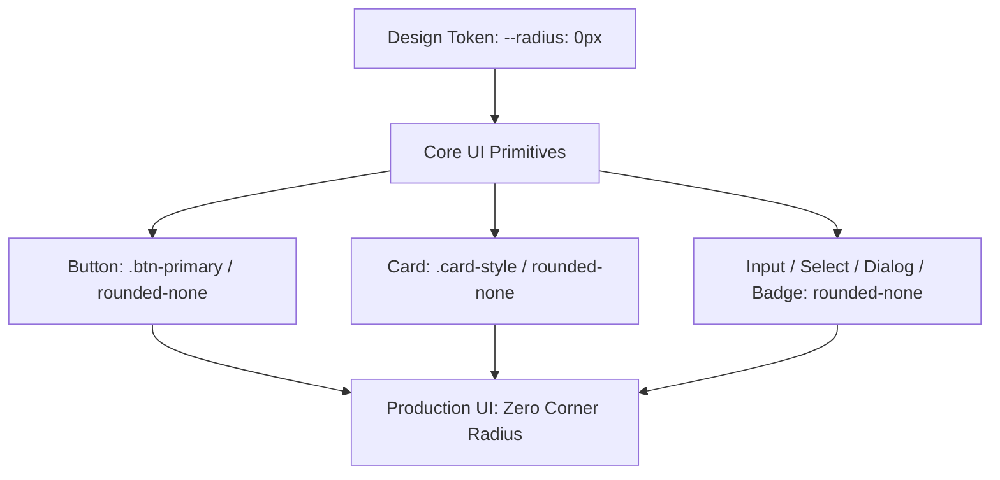

# ADR-002: Strict Zero-Radius Brutalist-Refined Geometry & Design System

- **Status**: Accepted
- **Date**: 2026-10-10
- **Deciders**: Electa Engineering & Design Systems Team
- **Technical Area**: Frontend Architecture, Design System, UI Engineering, Brand Identity

---

## 1. Context & Problem Statement

Modern software interfaces frequently suffer from aesthetic convergence: ubiquitous rounded corners (`rounded-lg`, `rounded-xl`, `rounded-2xl`, `rounded-full`), soft pastel shadows, and generic container cards. When AI coding agents generate interfaces without strict geometric constraints, they invariably default to cookie-cutter Tailwind templates or generic "AI slop" that looks indistinguishable from standard dashboard kits.

Electa is a high-stakes, institutional, and student-body democratic voting platform. It demands an interface that conveys **authority, precision, cryptographic integrity, and architectural intentionality**.

---

## 2. Decision Drivers

- **Brand Distinctiveness**: Establish an unmistakable, premium, and iconic visual signature ("Brutalist-Refined") that immediately differentiates Electa from casual SaaS products.
- **Architectural Rigor**: Align geometric structure with mathematical precision (0px border radius, crisp hairline boundaries, tabular typography).
- **Agent Determinism**: Provide coding agents with unambiguous styling constraints (`rounded-none`, `--radius: 0px`) to eliminate subjective radius drift.
- **Density & Clean Alignment**: Zero-radius geometry maximizes usable screen real estate and eliminates visual clipping along edge boundaries.

---

## 3. Considered Options

1. **Option 1: Standard Fluid Radius (`rounded-md` / `rounded-lg`)**:
   - _Cons_: Visually indistinguishable from generic Shadcn UI defaults; erodes institutional seriousness.
2. **Option 2: Mixed Radius (Pill buttons + rounded cards)**:
   - _Cons_: Introduces arbitrary styling choices; causes agents to mix inconsistent border radii across features.
3. **Option 3 (Chosen): Strict Zero-Radius Brutalist-Refined Geometry (`--radius: 0px`, `rounded-none`)**:
   - Sharp 0px corners across all cards, dialogs, buttons, inputs, filter pills, and navigation containers.
   - High-contrast hairline borders (`border-slate-300`, `dark:border-slate-800`).
   - Clean tabular micro-typography (Outfit headings, Sora body, JetBrains Mono data).

---

## 4. Decision & Architectural Architecture

We mandate **Strict Zero-Radius Brutalist-Refined Geometry** across the entire Electa application layer (`src/`).



### Specific Architectural Rules

1. **Strict 0px Corners**:
   - All interactive elements, cards, modals, dropdowns, badges, filter controls, and input fields MUST have **sharp 0px corners** (`--radius: 0px`, `rounded-none`).
   - ❌ **Strictly Forbidden**: `rounded-sm`, `rounded-md`, `rounded-lg`, `rounded-xl`, `rounded-2xl`, `rounded-3xl`, `rounded-full` (with the single exception below).
2. **Singular Exception (Avatar Photos)**:
   - User profile photos and contestant avatar circles MAY use `rounded-full` strictly for circular photographic masking.
3. **Core Design Tokens (`src/app/globals.css`)**:
   ```css
   :root {
     --radius: 0px;
   }
   ```
4. **Primary Component Primitives**:
   - Action Buttons: `.btn-primary` (800 weight, uppercase, tracking-widest, sharp 0px radius).
   - Card Surfaces: `.card-style` (pure white surface, hairline border `#CBD5E1`, 0px radius).
   - Filter Badges: Sharp rectangular badges with hairline borders.

---

## 5. Consequences

### Positive Impacts

- **Uncompromising Brand Identity**: Electa looks engineered, architectural, and serious, reinforcing democratic trust and cryptographic tally integrity.
- **Agent Output Consistency**: Removes subjective ambiguity for autonomous coding agents; eliminates "which radius should I use?" hallucinations.
- **Pixel-Perfect Alignment**: Modular grid alignment and nested containers snap seamlessly without awkward radius mismatch artifacts.

### Negative Impacts & Mitigations

- **Potential Visual Harshness**:
  - _Mitigation_: Balanced with refined typography (Outfit font, Sora font), subtle hairline borders (`border-slate-300`), and generous padding.
- **Third-Party Component Overrides**:
  - _Mitigation_: Base Shadcn UI primitives in `src/components/ui/` have `--radius: 0px` globally baked in via CSS custom properties.

---

## 6. Compliance, Enforcement & Verification

- **Rule File**: `.agents/rules/branding-and-design-system.md` (§2 Strict Zero-Radius Geometry).
- **ESLint Rule**: Auto-fix and lint-staged verify component class names.
- **Pre-Commit Hook**: Verified during `npm run agent:verify`.
