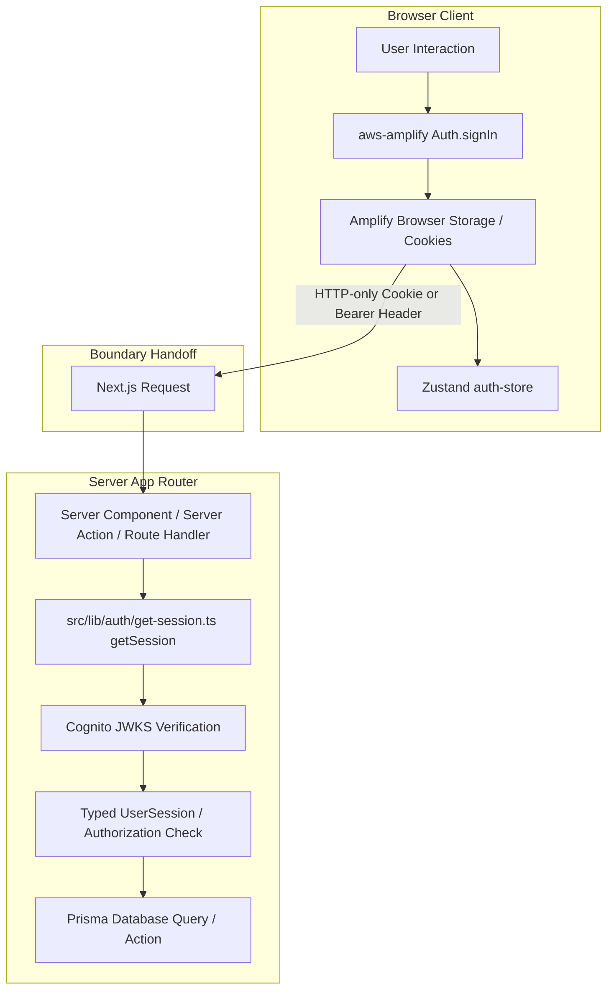

# ADR-004: AWS Amplify v6 Client-Side Boundary Isolation & Server-Side Cognito JWT Verification

- **Status**: Accepted
- **Date**: 2026-10-14
- **Deciders**: Electa Engineering & Cloud Architecture Team
- **Technical Area**: Authentication, Cloud Infrastructure (AWS Cognito), Next.js 16 App Router

---

## 1. Context & Problem Statement

AWS Amplify v6 is AWS's recommended client SDK for web applications integrating with AWS Cognito. However, the Amplify client runtime is inherently browser-centric: it relies on `window`, `localStorage`, `sessionStorage`, and web crypto APIs to manage Cognito user sessions and refresh tokens.

In Next.js 16 App Router, code executes across two fundamentally distinct environments:

1. **Server Environment** (React Server Components, Server Actions, Route Handlers).
2. **Client Environment** (Browser DOM, React Client Components, Zustand stores).

When developers or coding agents attempt to import `aws-amplify` or call Amplify auth methods (such as `fetchAuthSession()`, `getCurrentUser()`, or `signIn()`) inside Server Components or Route Handlers, the application crashes with fatal runtime exceptions (`ReferenceError: window is not defined`, hydration mismatches, or hanging event loops). Furthermore, attempting to manage server-side Cognito sessions through heavy client SDKs introduces unnecessary server bundle bloat and latency.

---

## 2. Decision Drivers

- **Zero Server Hydration Crashes**: Eliminate runtime `window is not defined` crashes in React Server Components and Route Handlers.
- **Strict Boundary Separation**: Decouple client authentication interactions from server-side cryptographic token verification.
- **High-Performance Server Verification**: Use lightweight, native JWT cryptographic verification (`aws-jwt-verify` / Web Crypto) on the server instead of bundling the full Amplify SDK.
- **Single Source of Truth**: Cloud infrastructure (Cognito User Pools, Clients, Domains) provisioned via Terraform in `infra/modules/cognito/` with typed handoff via `src/env.ts`.

---

## 3. Considered Options

1. **Option 1: Universal Amplify SSR Adapter (`@aws-amplify/adapter-nextjs`)**:
   - _Cons_: Adds heavy dependencies; forces server components to wrap requests in Amplify runWithAmplifyServerContext; high maintenance overhead with Next.js 16 canary updates.
2. **Option 2: Pure Client-Side Authentication (No Server Verification)**:
   - _Cons_: Critical security vulnerability; API routes and Server Actions cannot authenticate users or enforce Role-Based Access Control (RBAC).
3. **Option 3 (Chosen): Strict Client Isolation with Server-Side JWT Verification (`getSession()`)**:
   - Client-side: AWS Amplify v6 runs exclusively in the browser for user authentication flows.
   - Server-side: Server Components and Route Handlers verify Cognito JWTs using `getSession()` in `src/lib/auth/get-session.ts`.

---

## 4. Decision & Architectural Architecture

We mandate strict **Client-Side Boundary Isolation** for AWS Amplify v6 and dedicated **Server-Side Cognito JWT Verification**.

### Specific Architectural Rules

1. **Client-Side Amplify Scope**:
   - `Amplify.configure()` is executed once in a client-side provider (`src/lib/auth/amplify-config.ts`).
   - Browser authentication operations (`signIn`, `signUp`, `confirmSignUp`, `signOut`) are isolated to client components (`src/features/auth/components/`) and the Zustand store (`src/stores/auth-store.ts`).
   - ❌ **Prohibited**: Importing `@aws-amplify/*` or calling Amplify APIs inside Server Components, Route Handlers, or Server Actions.
2. **Server-Side Session Verification**:
   - All server-side auth checks MUST call `getSession()` from `src/lib/auth/get-session.ts`.
   - `getSession()` awaits Next.js request headers (`await headers()`) and cookies (`await cookies()`), extracts the Cognito ID or Access token, and validates its cryptographic signature against AWS Cognito's public JWKS endpoint (`aws-jwt-verify`).
3. **Infrastructure Handoff**:
   - All Cognito resources are defined as Infrastructure as Code in `infra/modules/cognito/`.
   - Resource identifiers (`COGNITO_USER_POOL_ID`, `NEXT_PUBLIC_COGNITO_CLIENT_ID`, `COGNITO_DOMAIN`) are exported via Terraform output and validated through `@/env` (`src/env.ts`).

---

## 5. Consequences

### Positive Impacts

- **Zero Hydration Errors**: Complete elimination of `window is not defined` errors across server rendering.
- **Minimal Server Bundle Size**: Server components do not load browser SDKs, drastically improving cold start performance.
- **Cryptographic Security**: Tokens are verified cryptographically using public key cryptography (RS256) on every protected request.

### Negative Impacts & Mitigations

- **Dual-Stack Auth Knowledge**:
  - _Mitigation_: Centralized in two clean abstraction layers: client-side auth in `src/stores/auth-store.ts`, server-side auth in `src/lib/auth/get-session.ts`.

---

## 6. Compliance, Enforcement & Verification

- **Constitution Rule**: Constitution §IV (Secure-by-Design & Auth Integrity).
- **Automated Guardrail Hook**: `.agents/scripts/check-constitution.mjs` prevents un-awaited headers/cookies in server auth flows.
- **Unit Tests**: `tests/unit/auth/token-adapter.test.ts` & `tests/unit/auth/auth.test.ts`.
