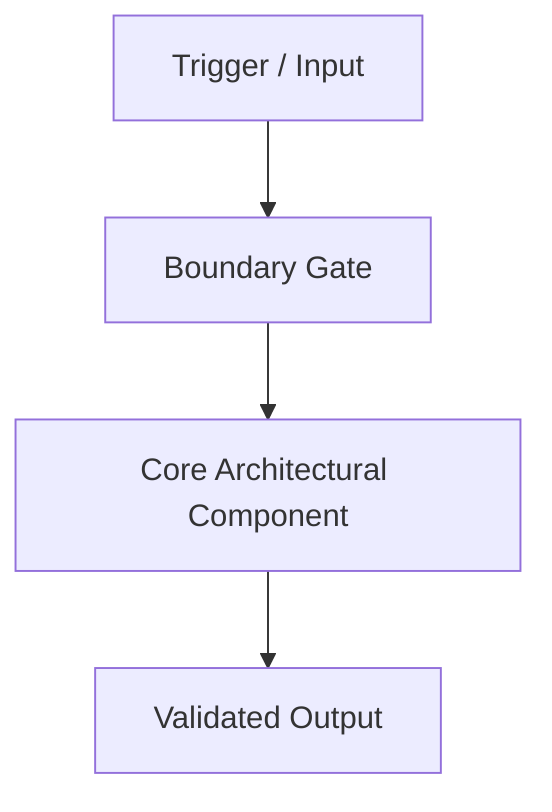

# [ADR-XXXX]: [Short title of solved problem and applied architectural decision]

- **Status**: [Proposed | Accepted | Superseded by ADR-YYYY | Deprecated]
- **Date**: YYYY-MM-DD
- **Deciders**: [List of decision makers and contributors]
- **Technical Area**: [e.g. Design System | Authentication | API Architecture | Cloud Infrastructure]

---

## 1. Context & Problem Statement

[Describe the context, problem, current challenges, forces, and pain points that necessitate an architectural decision. Explain the user impact, agent behavior issues, or technical debt.]

---

## 2. Decision Drivers

- [Driver 1: e.g. Brand distinctiveness, WCAG 2.1 AA accessibility, hydration safety]
- [Driver 2: e.g. Single source of truth, performance, agent guardrails]
- [Driver 3: e.g. Maintenance cost, cognitive load, third-party library boundaries]

---

## 3. Considered Options

1. **Option A**: [Description of candidate architecture]
2. **Option B**: [Description of candidate architecture]
3. **Option C**: [Description of candidate architecture]

---

## 4. Decision & Architectural Architecture

[Detailed explanation of the chosen approach, why it was chosen over alternatives, and concrete architectural rules.]

### Architectural Workflow / Diagram

### Specific Integration & Implementation Rules

1. **Rule 1**: [Concrete technical constraint]
2. **Rule 2**: [Concrete technical constraint]
3. **Rule 3**: [Concrete technical constraint]

---

## 5. Consequences

### Positive Impacts

- [Benefit 1]
- [Benefit 2]
- [Benefit 3]

### Negative Impacts & Mitigations

- **[Tradeoff / Risk 1]**:
  - _Mitigation_: [Specific mitigation strategy]
- **[Tradeoff / Risk 2]**:
  - _Mitigation_: [Specific mitigation strategy]

---

## 6. Compliance, Enforcement & Verification

- **Automated Guardrail Hook**: [Hook name and command in `.agents/hooks.json`]
- **Constitution Rule**: [Principle §I–§VI in `.specify/memory/constitution.md`]
- **Verification Gate**: [CLI command in `agent-verify.mjs`]
