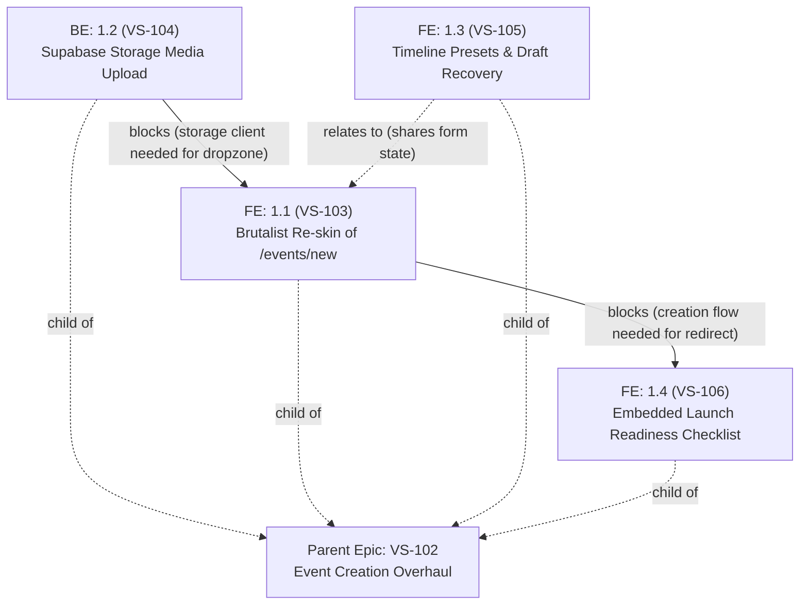

# [EPIC-VS-102] Event Creation Experience & Organizer Onboarding Overhaul

> **Jira Epic**: [**VS-102: [Epic] Event Creation Experience & Organizer Onboarding Overhaul**](https://the-three-devsketeers.atlassian.net/browse/VS-102)  
> **Status**: Ready for Implementation Planning / Backlog Grooming  
> **Target Release**: Sprint MVP  
> **Design Philosophy**: Brutalist-Refined Zero-Radius (`--radius: 0px`, `rounded-none`), Light-Mode Opal Default (`#F8FAFC`), Obsidian Dark Mode (`#090D16`), WCAG 2.1 AA  
> **Primary Persona**: Competition Organizer / Pageant Director

---

## 🎯 1. Executive Summary & Objective

Overhaul the event creation experience (`/events/new`) and the first-run organizer onboarding flow to deliver a high-converting, friction-free, and brand-compliant journey for competition organizers.

This epic addresses the critical UX friction points and design system discrepancies uncovered during the UI/UX audit:

- **Brand Alignment**: Replaces legacy rounded corners (`rounded-2xl`, `rounded-xl`, `rounded-lg`) and violet/indigo gradients with Electa's strict brutalist-refined zero-radius (`--radius: 0px`, `rounded-none`) and Opal Slate-50 palette.
- **Direct Media Upload (Supabase Storage Bucket)**: Integrates image upload using Supabase Storage bucket (e.g. `events`/`media` bucket) for public banner hosting, with an instant gradient fallback so missing artwork never blocks an organizer from creating an initial draft.
- **Frictionless Creation (<20s Time-to-Draft)**: Avoids artificial multi-step wizard overhead in favor of a focused, single-column progressive form with smart operational timeline presets.
- **Persistent Launch Readiness**: Replaces disruptive post-creation popup modals with a clean, embedded dashboard checklist guiding organizers through Divisions, Contestants, Voting Rules, and Event Launch.

---

## 💼 2. Business Value & Success Metrics (KPIs)

```
┌─────────────────────────────────────────────────────────────────────────────┐
│                            SUCCESS METRICS & KPIS                           │
│  • Time to First Draft: Reduced from ~90s to < 20s                          │
│  • Zero Drop-off on Missing Artwork: 100% of organizers can create drafts   │
│  • 100% Design System Parity: Strict 0px radius across all form elements     │
│  • Zero Cumulative Layout Shift (CLS < 0.02) during banner/slug updates      │
│  • WCAG 2.1 AA Compliance: Minimum 4.5:1 text contrast in Light & Dark mode │
└─────────────────────────────────────────────────────────────────────────────┘
```

---

## 🧱 3. Architecture & Visual Design Contract

- **Geometry**: Strict zero-radius (`--radius: 0px`, `rounded-none`). No rounded corners on inputs, buttons, cards, previews, or badges.
- **Color System**:
  - **Light Mode Default**: Opal Slate-50 background (`#F8FAFC`), pure white surfaces (`#FFFFFF`), Slate-900 typography (`#0F172A`), Sky Blue accent (`#0284C7`), hairline borders (`#CBD5E1` / `border-slate-300`).
  - **Dark Mode**: Obsidian background (`#090D16`), deep navy surfaces (`#0D1424`), Sky Blue accent (`#38BDF8`), hairline borders (`border-slate-800`).
- **Typography**:
  - Headings: `Outfit` (`font-heading`, bold uppercase).
  - Body & UI: `Sora` (`font-sans`, high legibility).
  - Slugs, Code & Timers: `JetBrains Mono` (`font-mono`, tabular numbers).
- **Component Architecture**:
  - Server Component shell at `src/app/(dashboard)/events/new/page.tsx` with session guard.
  - Isolated client form at `src/features/events/components/CreateEventForm.tsx` consuming `@/lib/validations/event`.
  - Reusable media dropzone from `@/features/media`.

---

## 🗺️ 4. Execution Order & Dependency Graph



| Order   | Jira Key                                                            | Story Summary                                                                     | Dependencies & Blocking Logic                           |
| :------ | :------------------------------------------------------------------ | :-------------------------------------------------------------------------------- | :------------------------------------------------------ |
| **1.1** | [VS-104](https://the-three-devsketeers.atlassian.net/browse/VS-104) | `BE: 1.2 Supabase Storage Media Upload Route & Presigned Client`                  | **Blocks** `VS-103` (Storage route needed for dropzone) |
| **1.2** | [VS-103](https://the-three-devsketeers.atlassian.net/browse/VS-103) | `FE: 1.1 Visual Design System & Brutalist Re-skin of /events/new`                 | **Blocked By** `VS-104`, **Blocks** `VS-106`            |
| **1.3** | [VS-105](https://the-three-devsketeers.atlassian.net/browse/VS-105) | `FE: 1.3 Smart Operational Timeline & Quick Duration Presets with Draft Recovery` | **Relates To** `VS-103` (Colocated form features)       |
| **1.4** | [VS-106](https://the-three-devsketeers.atlassian.net/browse/VS-106) | `FE: 1.4 Post-Creation Embedded Launch Readiness Checklist Widget`                | **Blocked By** `VS-103` (Needs completed creation flow) |

---

## 🧪 5. Testing & Verification Gate

1. **Unit & Component Testing**:
   - `tests/unit/events/create-event-form.test.tsx`: Form submission, debounced slug checking, media dropzone integration, quick presets.
   - `tests/unit/events/create-event-service.test.ts`: Atomic creation and audit log transaction.
2. **Quality Gates**:
   - `npm run typecheck` passes with zero TypeScript errors.
   - `npm run lint` passes with zero ESLint warnings.
   - `node .agents/skills/accessibility-colors/scripts/check-contrast.mjs` verifies WCAG AA compliance.
