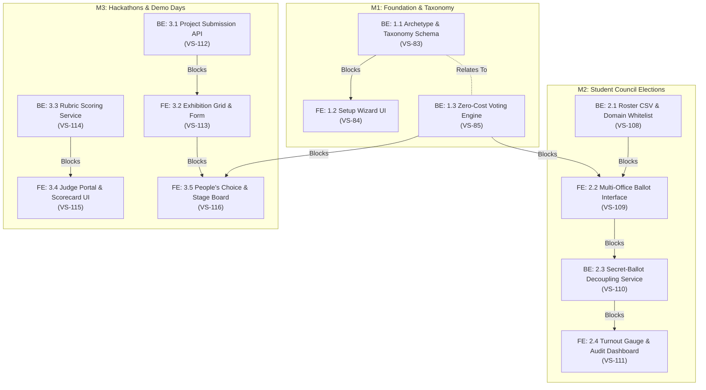

# EPIC: Multi-Archetype Election Engine (School Elections, Hackathons & Beyond)

- **Epic Key**: [VS-82](https://the-three-devsketeers.atlassian.net/browse/VS-82)
- **Status**: To Do
- **Target Milestones**: M1 (Foundation & Taxonomy), M2 (School Elections), M3 (Hackathons & Demo Days), M4 (Dynamic Form Engine)
- **Architecture & Rules**: Strict TypeScript 5 (§I), RSC-first boundary isolation (§II), Secret Ballot decoupling (§III, §IV), Opal light theme default with zero-radius geometry (`rounded-none`).

---

## 🎯 Epic Hypothesis & Business Value

**We believe that** by transforming Electa from a pageant-specific contest system into a generalized, multi-archetype voting platform with native profiles for **Student Council Elections (`STUDENT_COUNCIL`)**, **Hackathons & Pitch Days (`HACKATHON`)**, and **Pageants & Contests (`PAGEANT`)**,  
**School administrations, student councils, and hackathon organizers** will adopt Electa as their trusted voting and judging platform,  
**We will know this is successful when**:

1. At least 2 distinct non-pageant archetypes successfully complete full election/judging cycles in staging.
2. 100% of cast ballots in student council elections maintain strict cryptographic anonymity (participation recorded, ballot decoupled).
3. Zero regressions occur in existing pageant events, fan voting, or payment flows.

---

## 👥 Target Personas

- **School Election Commissioner**: Needs multi-office candidate slates, student ID/email domain whitelisting (`@school.edu`), and secret ballot auditability.
- **Student Voter**: Needs a unified multi-seat ballot with review & confirmation receipts on desktop and mobile.
- **Hackathon Director / Judge**: Needs project showcase submissions (repo, demo URLs) and multi-criteria weighted rubric scorecards (1–10).
- **Pageant Organizer / Public Voter**: Maintains existing fan voting, media galleries, and payment checkout flows.

---

## 📋 Decomposed Jira User Stories & Delivery Plan

All child tickets strictly enforce `FE: <Major>.<Minor>` / `BE: <Major>.<Minor>` formatting, Mike Cohn use cases, and Gherkin acceptance criteria.

| Key                                                                 | Title                                                                          | Layer           | Priority | Dependencies                                    | Status |
| :------------------------------------------------------------------ | :----------------------------------------------------------------------------- | :-------------- | :------- | :---------------------------------------------- | :----- |
| [VS-83](https://the-three-devsketeers.atlassian.net/browse/VS-83)   | `BE: 1.1 Event Archetype Schema, Taxonomy Models & Validation Service`         | Backend Schema  | High     | **Blocks** VS-84; **Relates To** VS-85          | To Do  |
| [VS-84](https://the-three-devsketeers.atlassian.net/browse/VS-84)   | `FE: 1.2 Archetype-Tailored Event Wizard & Taxonomy Configuration UI`          | Frontend UI     | High     | **Blocked By** VS-83                            | To Do  |
| [VS-85](https://the-three-devsketeers.atlassian.net/browse/VS-85)   | `BE: 1.3 Zero-Cost Institutional Voting Engine & Rate Limiter`                 | Backend Service | High     | **Blocks** VS-109, VS-116; **Relates To** VS-83 | To Do  |
| [VS-108](https://the-three-devsketeers.atlassian.net/browse/VS-108) | `BE: 2.1 Student Roster CSV Ingestion & Email Domain Whitelist Service`        | Backend API     | High     | **Blocks** VS-109; **Relates To** VS-83         | To Do  |
| [VS-109](https://the-three-devsketeers.atlassian.net/browse/VS-109) | `FE: 2.2 Student Council Voter Authentication & Multi-Office Ballot Interface` | Frontend UI     | High     | **Blocked By** VS-108, VS-85; **Blocks** VS-110 | To Do  |
| [VS-110](https://the-three-devsketeers.atlassian.net/browse/VS-110) | `BE: 2.3 Cryptographic Secret-Ballot Decoupling & Cast Ballot Processor`       | Backend Crypto  | High     | **Blocked By** VS-109; **Blocks** VS-111        | To Do  |
| [VS-111](https://the-three-devsketeers.atlassian.net/browse/VS-111) | `FE: 2.4 Real-Time Turnout Gauge & Certified Election Audit Dashboard`         | Frontend UI     | Medium   | **Blocked By** VS-110; **Relates To** VS-108    | To Do  |
| [VS-112](https://the-three-devsketeers.atlassian.net/browse/VS-112) | `BE: 3.1 Hackathon Project Submission API & Track Tagging Service`             | Backend API     | High     | **Blocks** VS-113; **Relates To** VS-83         | To Do  |
| [VS-113](https://the-three-devsketeers.atlassian.net/browse/VS-113) | `FE: 3.2 Hackathon Exhibition Grid & Project Submission Form`                  | Frontend UI     | High     | **Blocked By** VS-112; **Blocks** VS-116        | To Do  |
| [VS-114](https://the-three-devsketeers.atlassian.net/browse/VS-114) | `BE: 3.3 Multi-Criteria Judge Rubric Scoring & Aggregate Tallies Service`      | Backend Service | High     | **Blocks** VS-115; **Relates To** VS-112        | To Do  |
| [VS-115](https://the-three-devsketeers.atlassian.net/browse/VS-115) | `FE: 3.4 Dedicated Judge Portal & Weighted Rubric Scorecard UI`                | Frontend UI     | High     | **Blocked By** VS-114; **Relates To** VS-113    | To Do  |
| [VS-116](https://the-three-devsketeers.atlassian.net/browse/VS-116) | `FE: 3.5 Demo Day Attendee People's Choice Voting & Stage Leaderboard`         | Frontend UI     | Medium   | **Blocked By** VS-85, VS-113                    | To Do  |

---

## 🔗 Technical Dependency Graph

