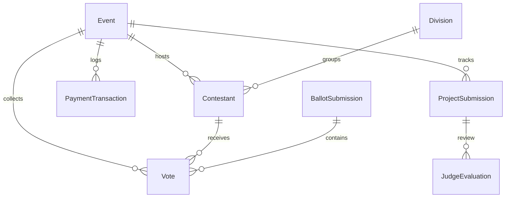

# Electa DB Schema Summary

> Compact schema map (< 500 tokens). Auto-generated from `prisma/schema.prisma`.

## Models

| Model | Fields | Relations |
|---|---|---|
| **Event** | slug, title | Contestant, Division |
| **Division** | name, displayOrder | Event, Contestant |
| **EventPosition** | name, maxSelect | Event, Contestant |
| **Contestant** | number, name | Event, Division |
| **ContestantMedia** | mediaType, url | Contestant |
| **AwardCategory** | name, isVotingOpen | Event, CategoryAssignment |
| **ContestantCategory** | — | Contestant, AwardCategory |
| **EventAuditLog** | action, changedBy | Event |
| **Vote** | voteType, voteWeight | Event, Contestant |
| **BallotSubmission** | — | Event, Vote |
| **VoterParticipation** | votedAt | Event |
| **BallotSelection** | — | Event, EventPosition |
| **PaymentTransaction** | refNo, amountInPhp | Event, Contestant |
| **PayoutRequest** | refNo, amountInPhp | Event |
| **ProjectSubmission** | title, repositoryUrl | Event, ProjectMember |
| **ProjectMember** | name, email | ProjectSubmission |
| **ProjectTrack** | trackName | ProjectSubmission |
| **ProjectLink** | label, url | ProjectSubmission |
| **RubricCriterion** | title, weight | Event, JudgeScore |
| **StudentRoster** | email | Event |
| **JudgeEvaluation** | isDraft, score | Event, JudgeScore |
| **JudgeScore** | score | JudgeEvaluation, RubricCriterion |
| **ProjectVote** | — | Event, ProjectSubmission |

## ER Diagram

## Enums

- **Enums**: Archetype (PAGEANT, STUDENT_COUNCIL, HACKATHON) | Status (DRAFT, PUBLISHED, ARCHIVED) | Vote (FREE, BOOST) | Payment (PENDING, PAID)
