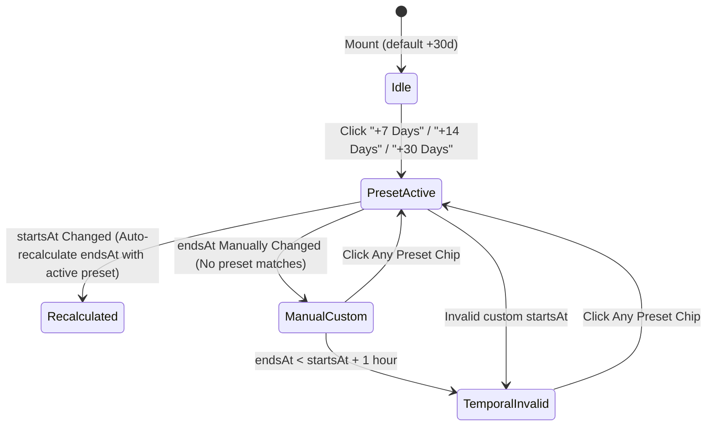

# Data Model & Storage Specifications: Smart Operational Timeline & Draft Recovery

**Feature ID**: `036-smart-operational-timeline`  
**Jira Key**: [VS-105](https://the-three-devsketeers.atlassian.net/browse/VS-105)  

---

## 1. Entities & Data Transfer Objects

### 1.1 Duration Preset Definition
```typescript
export interface TimelineDurationPreset {
  id: "7d" | "14d" | "30d";
  label: string; // e.g. "+7 Days", "+14 Days", "+30 Days"
  days: number;
}

export const TIMELINE_PRESETS: readonly TimelineDurationPreset[] = [
  { id: "7d", label: "+7 Days", days: 7 },
  { id: "14d", label: "+14 Days", days: 14 },
  { id: "30d", label: "+30 Days", days: 30 },
] as const;
```

### 1.2 Event Draft Storage Schema
Stored under key `electa:create_event_draft` in `sessionStorage`:

```typescript
export interface CreateEventDraft {
  title: string;
  slug: string;
  description: string;
  bannerUrl: string;
  startsAt: string; // YYYY-MM-DDTHH:mm
  endsAt: string;   // YYYY-MM-DDTHH:mm
  isCustomSlug?: boolean;
  savedAt: number;  // timestamp (ms)
}
```

---

## 2. Validation Constraints

| Field | Type | Storage Rule | Form Constraint |
| --- | --- | --- | --- |
| `title` | `string` | max 120 chars | Required, 3–120 chars |
| `slug` | `string` | kebab-case | Required, 3–60 chars, reserved check |
| `description` | `string` | text | Required, 10–5000 chars |
| `bannerUrl` | `string` | URL string | Required URL |
| `startsAt` | `string` | `YYYY-MM-DDTHH:mm` | Valid date |
| `endsAt` | `string` | `YYYY-MM-DDTHH:mm` | `endsAt >= startsAt + 1 hour` |
| `savedAt` | `number` | Unix epoch (ms) | Auto-generated on write |

---

## 3. State Machine: Operational Timeline Presets


