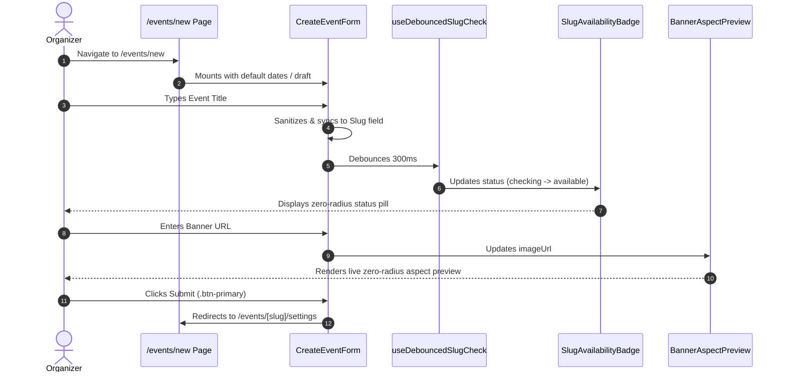

# Data Model & Component State Specifications: Visual Design System & Brutalist Re-skin of /events/new

**Feature ID**: `037-brutalist-reskin-events-new`  
**Jira Key**: [VS-103](https://the-three-devsketeers.atlassian.net/browse/VS-103)  
**Parent Epic**: [VS-102](https://the-three-devsketeers.atlassian.net/browse/VS-102)  

---

## 1. Entities & UI State Models

### 1.1 Slug Availability Status Model
```typescript
export type SlugAvailabilityStatus =
  | "idle"
  | "checking"
  | "available"
  | "unavailable"
  | "reserved"
  | "invalid";

export interface SlugAvailabilityBadgeProps {
  status: SlugAvailabilityStatus;
  message?: string | undefined;
  className?: string | undefined;
}
```

### 1.2 Banner Aspect Ratio Model
```typescript
export type AspectRatioPreset = "16:9" | "21:9";

export interface BannerAspectPreviewProps {
  imageUrl: string;
  title?: string;
  className?: string;
}
```

### 1.3 CreateEventForm Props & Form Values
```typescript
export interface CreateEventFormProps {
  onSuccess?: (slug: string) => void;
  onCancel?: () => void;
  className?: string;
}

export interface FormRawValues {
  title: string;
  slug: string;
  description: string;
  bannerUrl: string;
  startsAt: string;
  endsAt: string;
}
```

---

## 2. Design Tokens & Geometric Constraints

| Element | Geometry Token | Typography Token | Light Mode Styles | Dark Mode Styles |
| --- | --- | --- | --- | --- |
| Page Background | `rounded-none` | `font-sans` | `bg-slate-50 text-slate-900` | `dark:bg-slate-950 dark:text-slate-100` |
| Form Card | `rounded-none` | `font-sans` | `bg-white border-slate-300 shadow-xs` | `dark:bg-[#0d1424] dark:border-slate-800` |
| Section Headings | `rounded-none` | `font-heading font-bold` | `text-slate-900` | `dark:text-white` |
| Text Inputs / Areas | `rounded-none` | `font-sans` | `border-slate-300 bg-white text-slate-900` | `dark:border-slate-700 dark:bg-slate-950 dark:text-white` |
| Slug Input | `rounded-none` | `font-mono` | `text-slate-900` | `dark:text-white` |
| Slug Prefix `/events/`| `rounded-none` | `font-mono font-semibold` | `bg-slate-100 border-slate-200 text-slate-600` | `dark:bg-slate-900/80 dark:border-slate-800 dark:text-slate-400` |
| Slug Status Badge | `rounded-none` | `font-mono font-medium text-xs` | Theme-scoped background & border | Theme-scoped background & border |
| Primary Action Button | `rounded-none` | `font-sans font-extrabold uppercase tracking-widest text-xs` | `bg-slate-900 text-white border-slate-900 hover:bg-slate-800` | `dark:bg-slate-100 dark:text-slate-900 dark:border-slate-100 dark:hover:bg-slate-200` |
| Secondary Button | `rounded-none` | `font-sans font-bold uppercase tracking-wider text-xs` | `border-slate-300 bg-slate-100 text-slate-700 hover:bg-slate-200` | `dark:border-slate-700 dark:bg-slate-800/60 dark:text-slate-300 dark:hover:bg-slate-800` |
| Aspect Ratio Pill | `rounded-none` | `font-sans font-semibold text-xs` | Active: `bg-white text-slate-900 shadow-xs`; Inactive: `text-slate-600` | Active: `dark:bg-slate-800 dark:text-slate-100`; Inactive: `dark:text-slate-400` |

---

## 3. Component Interaction Flow


