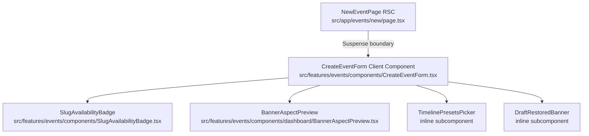

# Architecture & Implementation Plan: Visual Design System & Brutalist Re-skin of /events/new

**Feature ID**: `037-brutalist-reskin-events-new`  
**Jira Key**: [VS-103](https://the-three-devsketeers.atlassian.net/browse/VS-103)  
**Parent Epic**: [VS-102](https://the-three-devsketeers.atlassian.net/browse/VS-102)  
**Status**: In Progress  

---

## 1. Architectural Strategy

The goal of this refactor is to bring the `/events/new` route and its associated components into 100% compliance with Electa's Brutalist design system, WCAG 2.1 AA dual-theme standards, brand typography rules, and touch-target sizing guidelines without regressing existing form validation, draft recovery, or submission logic.

---

## 2. Boundary Mapping & Changes

### 2.1 `src/app/(dashboard)/events/new/page.tsx`
- Ensure page background defaults to Light mode Opal `#F8FAFC` (`bg-slate-50 text-slate-900 transition-colors sm:px-6 lg:px-8 dark:bg-slate-950 dark:text-slate-100`).
- Ensure breadcrumb button has comfortable touch target and typography (`font-sans font-bold`).
- Ensure header uses `font-heading font-black tracking-tight` (`Outfit`).
- Ensure sub-heading uses `font-sans` (`Sora`).
- Ensure setup wizard badge exhibits `rounded-none`.

### 2.2 `src/features/events/components/SlugAvailabilityBadge.tsx`
- Replace `rounded-full` with `rounded-none`.
- Update classes to use `font-mono text-xs font-semibold uppercase tracking-wider`.
- Ensure high-contrast colors (Emerald-800 on Emerald-50, Rose-800 on Rose-50, Amber-900 on Amber-50, etc.).

### 2.3 `src/features/events/components/dashboard/BannerAspectPreview.tsx`
- Remove all instances of `rounded-lg`, `rounded-md`, `rounded-xl`, `rounded-full`.
- Use `rounded-none` on aspect ratio toggle pills, preview viewport, aspect overlay badge, and empty state icons.
- Aspect ratio pill toggle buttons must have zero radius (`rounded-none`).
- Replace off-brand `border-violet-500` spinner with `border-sky-600 dark:border-sky-400`.
- Aspect overlay badge: `rounded-none font-mono text-[10px]`.

### 2.4 `src/features/events/components/CreateEventForm.tsx`
- Container card: `.card-style` brutalist appearance (`bg-white border border-slate-300 rounded-none shadow-xs dark:bg-[#0d1424] dark:border-slate-800`).
- Headings: `font-heading text-lg font-bold text-slate-900 dark:text-white`.
- Labels: `font-sans text-xs font-bold uppercase tracking-wider text-slate-900 dark:text-slate-200`.
- Text inputs and textareas: `rounded-none border border-slate-300 bg-white font-sans text-sm text-slate-900 placeholder-slate-400 focus:border-sky-600 focus:ring-1 focus:ring-sky-600 dark:border-slate-700 dark:bg-slate-950 dark:text-white`.
- Slug input container & input: `font-mono text-sm rounded-none`.
- Reset to Title button: `min-h-[44px] inline-flex items-center gap-1.5 px-2 py-1 text-xs font-bold text-sky-700 hover:text-sky-900 dark:text-sky-400 dark:hover:text-sky-300 cursor-pointer`.
- Primary Action button: `.btn-primary` standard (`bg-slate-900 text-white dark:bg-slate-100 dark:text-slate-900 font-extrabold uppercase tracking-widest text-xs border border-slate-900 dark:border-slate-100 rounded-none shadow-xs hover:bg-slate-800 dark:hover:bg-slate-200 min-h-[44px] px-6`).
- Cancel button: `rounded-none border border-slate-300 bg-slate-100 px-5 min-h-[44px] text-xs font-bold uppercase tracking-wider text-slate-700 hover:bg-slate-200 dark:border-slate-700 dark:bg-slate-800/60 dark:text-slate-300 dark:hover:bg-slate-800`.
- Clear Draft button on alert: `min-h-[44px]` touch target, zero radius.

---

## 3. Testing Strategy

1. **Unit Tests (`tests/unit/events/create-event-form.test.tsx`)**:
   - Assert zero-radius classes (`rounded-none`) across form card, inputs, and buttons.
   - Assert `font-mono` on slug input and badge.
   - Assert `.btn-primary` classes on submit button.
   - Assert `min-h-[44px]` on interactive buttons (reset to title, submit, cancel, clear draft).
   - Assert real-time debounced slug check updates badge.
   - Assert reset to title button functionality.
2. **Page Unit Tests (`tests/unit/events/create-event-page.test.tsx`)**:
   - Assert correct rendering, metadata, and authentication redirection.
