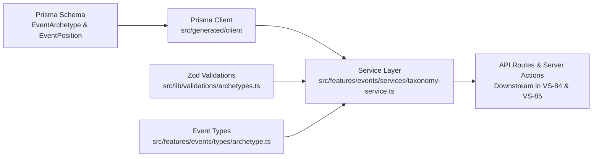

# Implementation Plan: Event Archetype Schema, Taxonomy Models & Validation Service

**Feature ID**: `040-event-archetype-schema-taxonomy`  
**Ticket**: [VS-83](https://the-three-devsketeers.atlassian.net/browse/VS-83)  
**Parent Epic**: [VS-102](https://the-three-devsketeers.atlassian.net/browse/VS-102)  
**Branch**: `feature/VS-83-event-archetype-schema-taxonomy`  

---

## 1. Architecture & Component Mapping

### Directory Structure & Target Files

- `prisma/schema.prisma` — Schema definitions for `EventArchetype`, `EventPosition`, and relation updates.
- `prisma/migrations/20261013000000_add_event_archetype_and_positions/` — Safe Prisma migration.
- `src/lib/validations/archetypes.ts` — Zod schemas for archetype and position models.
- `src/features/events/types/archetype.ts` — Domain types, DTOs, and preset definitions.
- `src/features/events/services/taxonomy-service.ts` — Prisma data access service for archetype taxonomy.
- `tests/unit/events/archetype-validation.test.ts` — Unit tests for Zod schemas.
- `tests/unit/events/taxonomy-service.test.ts` — Unit tests for the taxonomy service.

---

## 2. Technical Implementation Phases

### Phase 1: Schema & Safe Migration
1. Update `prisma/schema.prisma`:
   - Add `enum EventArchetype` (`PAGEANT`, `STUDENT_COUNCIL`, `HACKATHON`, `CUSTOM`).
   - Add `archetype EventArchetype @default(PAGEANT)` to `Event`.
   - Add `model EventPosition` with `eventId`, `name`, `description`, `maxSelectionsPerVoter`, `minSelectionsPerVoter`, `displayOrder`, `isVotingOpen`.
   - Add `positionId String?` and relation on `Contestant`.
   - Add `positionId String?` and relation on `Vote`.
2. Execute migration via `db-migrate` / `prisma migrate` and regenerate Prisma client.

### Phase 2: Domain Types & Contracts
1. Create `src/features/events/types/archetype.ts` exporting:
   - `EventArchetype`
   - `EventPositionDto`
   - `UnifiedTaxonomyDto`
   - Archetype metadata configs (`EVENT_ARCHETYPE_CONFIGS`)
2. Update `src/features/events/types/index.ts` to re-export archetype types.

### Phase 3: Zod Validation Schemas
1. Create `src/lib/validations/archetypes.ts`:
   - `eventArchetypeSchema`
   - `createEventPositionSchema`
   - `updateEventPositionSchema`
   - `reorderPositionsSchema`
   - `updateEventArchetypeSchema`
2. Create unit tests in `tests/unit/events/archetype-validation.test.ts`.

### Phase 4: Taxonomy Service
1. Create `src/features/events/services/taxonomy-service.ts`:
   - `getEventTaxonomy(eventIdOrSlug: string): Promise<UnifiedTaxonomyDto>`
   - `createEventPosition(eventId: string, input: CreateEventPositionInput)`
   - `updateEventPosition(eventId: string, positionId: string, input: UpdateEventPositionInput)`
   - `deleteEventPosition(eventId: string, positionId: string)`
   - `reorderEventPositions(eventId: string, positionIds: string[])`
   - `updateEventArchetype(eventId: string, archetype: EventArchetype)`
2. Create unit tests in `tests/unit/events/taxonomy-service.test.ts`.

### Phase 5: Backward Compatibility & Quality Gates
1. Verify existing tests still pass: `npm run test:unit`.
2. Run `npm run typecheck` and `npm run lint`.
3. Auto-PR via `pr-creator`.
