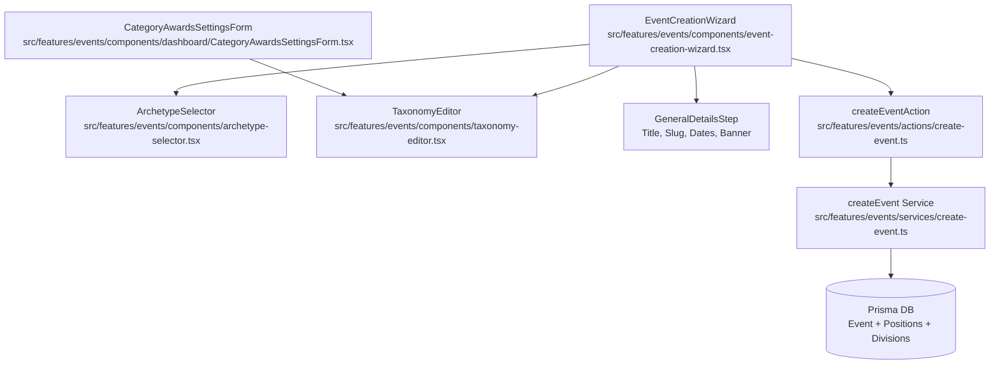

# Technical Plan: Archetype-Tailored Event Wizard & Taxonomy Configuration UI

**Feature ID**: `041-archetype-tailored-event-wizard`  
**Ticket**: [VS-84](https://the-three-devsketeers.atlassian.net/browse/VS-84)  
**Parent Epic**: [VS-82](https://the-three-devsketeers.atlassian.net/browse/VS-82)  
**Branch**: `feature/VS-84-archetype-tailored-event-wizard`  

---

## 1. Technical Architecture & Boundaries

---

## 2. Implementation Steps

### Phase 1: Validations & Contracts
- Implement `archetype-wizard.ts` schemas under `src/lib/validations/archetype-wizard.ts` validating conditional requirements (e.g. Hackathon tracks requirement, position constraints).
- Update `createEventSchema` to accept `archetype` and optional initial taxonomy items.
- Write unit tests for dynamic wizard validation rules in `tests/unit/events/archetype-wizard-validation.test.ts`.

### Phase 2: Component Architecture
- **`archetype-selector.tsx`**:
  - Displays archetype options (`PAGEANT`, `STUDENT_COUNCIL`, `HACKATHON`, `CUSTOM`).
  - Strict zero-radius brutalist styling, Opal light mode theme (`#F8FAFC`), dark mode parity.
  - Terminology preview pills (`Office / Position`, `Candidate`, `Track`, `Team / Project`).
  - Unit tests in `tests/unit/events/archetype-selector.test.tsx`.
- **`taxonomy-editor.tsx`**:
  - Renders position/office manager for `STUDENT_COUNCIL` / `HACKATHON` / `CUSTOM`, and division manager for `PAGEANT`.
  - Seat limits input (`maxSelectionsPerVoter`, `minSelectionsPerVoter`), ordering, and presets.
  - Supports both in-memory draft mode (wizard) and remote mutation mode (settings page).
  - Unit tests in `tests/unit/events/taxonomy-editor.test.tsx`.
- **`event-creation-wizard.tsx`**:
  - Multi-step wizard integrating step indicators, general details, archetype selector, and taxonomy editor.
  - Preserves general details across archetype switches.
  - Replaces or enhances `CreateEventForm.tsx` for seamless integration in `/events/new`.
  - Unit tests in `tests/unit/events/event-creation-wizard.test.tsx`.

### Phase 3: Service & Action Integration
- Update `src/features/events/services/create-event.ts` and `src/features/events/actions/create-event.ts`:
  - Persist `archetype` to the created Event.
  - Insert initial positions/divisions/categories atomically if provided during wizard submission.
- Update `CategoryAwardsSettingsForm.tsx` in `/events/[slug]/settings`:
  - Display archetype-tailored taxonomy (positions for `STUDENT_COUNCIL`, tracks for `HACKATHON`, divisions for `PAGEANT`).

### Phase 4: Verification & Quality Gates
- Run all test suites: `npm run test:unit tests/unit/events/` and `npm run test:unit`.
- Run typecheck and linting: `npm run typecheck && npm run lint`.
- Verify Electa Constitution §I–§VI.

---

## 3. Risks & Mitigations

| Risk | Impact | Mitigation |
| :--- | :--- | :--- |
| Form state lost on archetype switch | High | Common fields stored in top-level React Hook Form state; switching archetypes only mutates `archetype` field without resetting form values. |
| Existing pageant events broken | Critical | `archetype` defaults to `PAGEANT`; existing pageant components retain 100% backward compatibility. |
| Mobile horizontal overflow | Medium | Use responsive flex/grid wrappers (`grid-cols-1 sm:grid-cols-2 lg:grid-cols-4`) and touch target >= 44px. |
