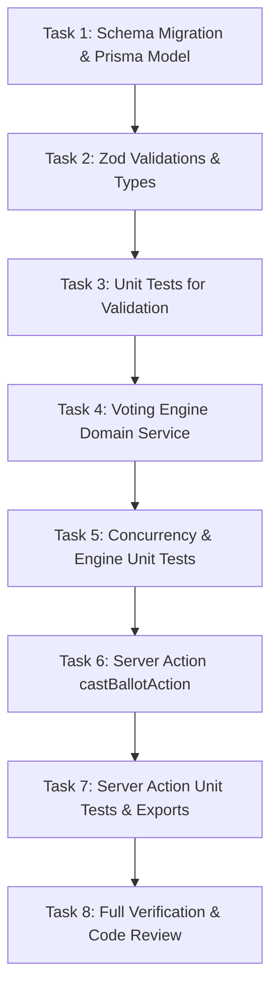

# Implementation Tasks: Zero-Cost Institutional Voting Engine & Rate Limiter

**Feature**: `042-zero-cost-institutional-voting-engine`  
**Ticket**: [VS-85](https://the-three-devsketeers.atlassian.net/browse/VS-85)  

---

## Task Overview & Dependencies

---

## Phase 1: Database Foundation

- [ ] **Task 1.1: Schema Update & Migration**
  - Update `prisma/schema.prisma` with `isFreeVotingOnly Boolean @default(false)` on `Event`, `model BallotSubmission` with `@@unique([eventId, voterId])`, and `ballotSubmissionId` on `Vote`.
  - Create migration `prisma/migrations/20261013180000_add_ballot_submission_and_free_voting_only/migration.sql`.
  - Regenerate client with `npx prisma generate`.
  - Commit: `feat(db): add BallotSubmission model and isFreeVotingOnly flag`

---

## Phase 2: Contracts, Types & Validations (TDD)

- [ ] **Task 2.1: Types & Zod Schemas**
  - Implement `src/lib/validations/ballot.ts` with `officeSelectionSchema` and `castBallotSchema`.
  - Implement `src/features/voting/types/ballot.ts` and update `src/features/voting/types/index.ts`.
  - Commit: `feat(voting): add ballot validation schemas and domain DTOs`

- [ ] **Task 2.2: Unit Tests for Ballot Validations**
  - Implement `tests/unit/voting/ballot-validation.test.ts` testing bounds, missing fields, and office structure.
  - Run and verify tests pass.
  - Commit: `test(voting): add unit tests for ballot validation schemas`

---

## Phase 3: Domain Service Implementation (TDD)

- [ ] **Task 3.1: Voting Engine Unit Tests (Red Phase)**
  - Write tests in `tests/unit/voting/voting-engine.test.ts` for:
    - Zero-cost institutional voting execution.
    - Single-ballot rate limit and duplicate rejection (`BALLOT_ALREADY_SUBMITTED`).
    - Position min/max selection bounds enforcement.
    - Concurrent submission race condition simulation.
  - Commit: `test(voting): add unit tests for institutional voting engine`

- [ ] **Task 3.2: Voting Engine Implementation (Green Phase)**
  - Implement `src/features/voting/services/voting-engine.ts` with `isZeroCostElection`, `hasVoterSubmittedBallot`, and `castInstitutionalBallot`.
  - Ensure atomic `db.$transaction` with unique violation handling.
  - Verify all unit tests pass.
  - Commit: `feat(voting): implement zero-cost institutional voting engine`

---

## Phase 4: Server Action & Integration

- [ ] **Task 4.1: Server Action Implementation**
  - Implement `src/features/voting/actions/cast-ballot.ts` with session authentication via `getSession()`, IP extraction, and standardized response envelope.
  - Export from `src/features/voting/index.ts`.
  - Implement tests in `tests/unit/voting/cast-ballot-action.test.ts`.
  - Commit: `feat(voting): add castBallotAction server action and tests`

---

## Phase 5: Verification, Code Review & PR

- [ ] **Task 5.1: Quality & Constitution Gates**
  - Run `npm run typecheck`, `npm run lint`, and `npm run test:unit`.
  - Run code review gates (`code-review` and `code-review-and-quality`).
  - Commit any refactorings atomically (`refactor(...)`).
- [ ] **Task 5.2: Automated PR Creation & Jira Update**
  - Rebase on `origin/main`.
  - Open PR via `gh pr create` with `.specify/pr-body.md`.
  - Post update comment to Jira issue VS-85.
