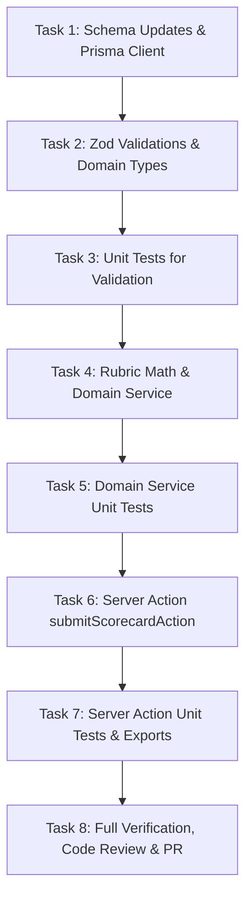

# Implementation Tasks: Multi-Criteria Judge Rubric Scoring & Aggregate Tallies Service

**Feature**: `043-judge-rubric-scoring-service`  
**Ticket**: [VS-114](https://the-three-devsketeers.atlassian.net/browse/VS-114)  
**Parent Epic**: [VS-82](https://the-three-devsketeers.atlassian.net/browse/VS-82)  

---

## Task Overview & Dependencies

---

## Phase 1: Database Foundation

- [x] **Task 1.1: Schema Update & Migration**
  - Add `RubricCriterion`, `JudgeEvaluation`, and `JudgeScore` models to `prisma/schema.prisma` with bidirectional relations on `Event`.
  - Create migration SQL and regenerate Prisma client with `npx prisma generate`.
  - Commit: `feat(db): add RubricCriterion, JudgeEvaluation, and JudgeScore models`

---

## Phase 2: Contracts, Types & Validations (TDD)

- [x] **Task 2.1: Types & Zod Schemas**
  - Implement `src/lib/validations/rubric.ts` with `criterionScoreInputSchema`, `submitScorecardSchema`, and `rubricCriterionSchema`.
  - Implement `src/features/hackathons/types/rubric.ts` and barrel exports.
  - Commit: `feat(hackathons): add rubric validation schemas and domain DTOs`

- [x] **Task 2.2: Unit Tests for Rubric Validations**
  - Implement `tests/unit/hackathons/rubric-validation.test.ts` testing bounds (1-10), UUID validation, empty scores, and notes limits.
  - Commit: `test(hackathons): add unit tests for rubric validation schemas`

---

## Phase 3: Domain Service Implementation (TDD)

- [x] **Task 3.1: Rubric Math & Service Tests (Red Phase)**
  - Implement `tests/unit/hackathons/rubric-math.test.ts` for weighted composite score precision.
  - Implement `tests/unit/hackathons/rubric-service.test.ts` for draft vs final score exclusion, aggregate project tallies, and leaderboard sorting.
  - Commit: `test(hackathons): add unit tests for rubric calculation and domain service`

- [x] **Task 3.2: Rubric Domain Service Implementation (Green Phase)**
  - Implement `src/features/hackathons/services/rubric-service.ts` with:
    - `calculateWeightedScore`
    - `submitJudgeEvaluation`
    - `getJudgeEvaluation`
    - `getProjectAggregateScore`
    - `getEventLeaderboard`
  - Ensure atomic Prisma transaction and draft exclusion in aggregations.
  - Verify all unit tests pass.
  - Commit: `feat(hackathons): implement multi-criteria rubric scoring service`

---

## Phase 4: Server Action & Integration

- [x] **Task 4.1: Server Action Implementation & Tests**
  - Implement `src/features/hackathons/actions/submit-scorecard.ts` with `getSession()` auth check and judge role enforcement (`isJudge: true` or `role === "JUDGE"` or organizer/admin).
  - Implement `tests/unit/hackathons/submit-scorecard-action.test.ts` testing 401 unauthenticated, 403 non-judge, and 200 happy path.
  - Update `src/features/hackathons/index.ts` barrel export.
  - Commit: `feat(hackathons): add submitScorecardAction server action and tests`

---

## Phase 5: Verification, Code Review & PR

- [x] **Task 5.1: Quality & Constitution Gates**
  - Run `npm run typecheck`, `npm run lint`, and `npm run test:unit`.
  - Run two-axis code review (`code-review`) and multi-axis quality audit (`code-review-and-quality`).
  - Commit any refactorings atomically (`refactor(...)`).
- [x] **Task 5.2: Automated PR Creation & Jira Update**
  - Rebase on `origin/main`.
  - Open PR via `gh pr create` with `.specify/pr-body.md`.
  - Post update comment to Jira issue VS-114.
