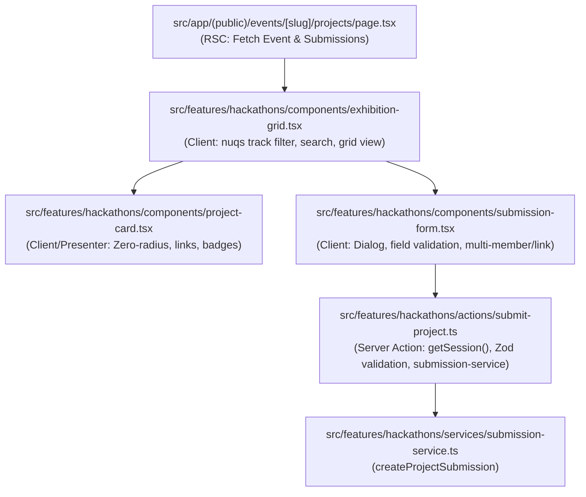

# Technical Implementation Plan: Hackathon Exhibition Grid & Project Submission Form

**Feature ID**: `045-hackathon-exhibition-grid-project-submission-form`  
**Ticket**: [VS-113](https://the-three-devsketeers.atlassian.net/browse/VS-113)  

---

## 1. Architectural Overview & Boundaries

---

## 2. Component Specifications

### 2.1 Project Card (`project-card.tsx`)
- Props: `submission: ProjectSubmissionDto`
- Header:
  - Project Title (`font-heading font-extrabold text-lg text-slate-900 dark:text-slate-100`)
  - Tagline or subtitle (`font-body text-xs text-slate-600 dark:text-slate-300`)
  - Status badge: `SUBMITTED`, `ACCEPTED`, etc.
- Track tags:
  - Rendered with sharp zero-radius badge (`Badge variant="accent"` or neutral pill badge).
- Body:
  - Truncated description snippet.
  - Team members roster (avatars or names with count).
- Footer / Actions:
  - GitHub / GitLab link chip (`target="_blank"`, `rel="noopener noreferrer"` with GitHub icon).
  - Live Demo link chip (if `demoUrl` provided).
  - Video Presentation link chip (if `videoUrl` provided).
  - Custom links (if present in `submission.links`).

### 2.2 Exhibition Grid (`exhibition-grid.tsx`)
- Props:
  - `eventSlug: string`
  - `eventTitle: string`
  - `submissions: ProjectSubmissionDto[]`
  - `isSubmissionOpen: boolean`
  - `availableTracks: string[]`
- Features:
  - Track filter pills synced with `nuqs` (`?track=...`). "All Tracks" default pill.
  - Search input for real-time title / description filtering.
  - Responsive CSS grid (`grid-cols-1 md:grid-cols-2 lg:grid-cols-3 gap-6`).
  - Empty state with "Clear Filter" button when no projects match.
  - "Submit Project" action button opening `SubmissionForm` dialog.

### 2.3 Project Submission Form (`submission-form.tsx`)
- Props:
  - `eventSlug: string`
  - `isOpen: boolean`
  - `onClose: () => void`
  - `availableTracks?: string[]`
  - `onSuccess?: (submission: ProjectSubmissionDto) => void`
- Form fields:
  - Title, Tagline, Description (textarea)
  - Repository URL (validated for github.com / gitlab.com)
  - Live Demo URL & Video Presentation URL
  - Track selector (checkboxes / pills or custom input)
  - Team members dynamic list (add/remove member)
- Validation:
  - Client-side validation against `createProjectSubmissionSchema` before submission.
  - Server action call with inline error highlights on failure.

### 2.4 Server Action (`src/features/hackathons/actions/submit-project.ts`)
- Authenticates session via `getSession()`.
- Validates payload with `createProjectSubmissionSchema`.
- Calls `createProjectSubmission(eventSlug, session.userId, parsed.data)`.
- Revalidates event project route with `revalidatePath('/events/${eventSlug}/projects')`.
- Returns typed `SubmitProjectActionResult`.

### 2.5 Page Route (`src/app/(public)/events/[slug]/projects/page.tsx`)
- RSC retrieving event by slug from DB (`db.event.findUnique`).
- Checks if event archetype is `HACKATHON`.
- Fetches all submissions via `getProjectSubmissions(event.id)`.
- Extracts unique track tags from existing submissions and event positions.
- Checks if current time is within `startsAt` and `endsAt` to derive `isSubmissionOpen`.
- Wraps `ExhibitionGrid` inside `<Suspense>`.
