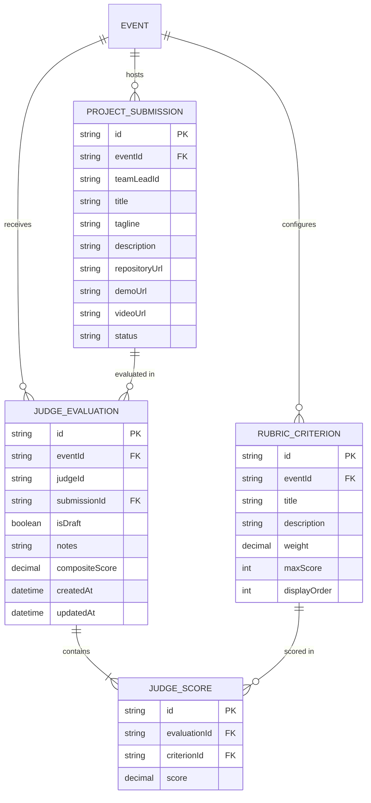
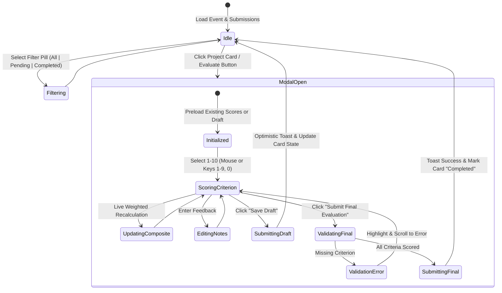

# Data Model: Dedicated Judge Portal & Weighted Rubric Scorecard UI

**Feature ID**: `045-judge-portal-rubric-scorecard`  
**Ticket**: [VS-115](https://the-three-devsketeers.atlassian.net/browse/VS-115)  
**Parent Epic**: [VS-82](https://the-three-devsketeers.atlassian.net/browse/VS-82)  

---

## 1. Entity Relationships & Schemas

The frontend components interface directly with the Prisma models introduced in VS-114 (`RubricCriterion`, `JudgeEvaluation`, `JudgeScore`, `ProjectSubmission`).



---

## 2. Frontend State Machine: Judge Portal & Scorecard



---

## 3. UI Data Transfer Objects (DTOs)

### `JudgePortalProjectItem`
```typescript
export interface JudgePortalProjectItem {
  id: string;
  title: string;
  tagline: string | null;
  description: string;
  repositoryUrl: string;
  demoUrl: string | null;
  videoUrl: string | null;
  status: "SUBMITTED" | "ACCEPTED" | "REJECTED" | "WINNER";
  trackTags: string[];
  evaluationStatus: "PENDING" | "DRAFT" | "COMPLETED";
  existingEvaluation?: {
    compositeScore: number;
    notes: string | null;
    isDraft: boolean;
    scores: Array<{
      criterionId: string;
      score: number;
    }>;
  };
}
```

### `RubricCriterionViewDto`
```typescript
export interface RubricCriterionViewDto {
  id: string;
  title: string;
  description: string | null;
  weight: number;
  maxScore: number;
  displayOrder: number;
}
```
