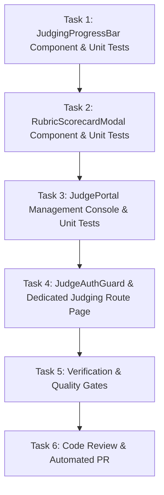

# Implementation Tasks: Dedicated Judge Portal & Weighted Rubric Scorecard UI

**Feature ID**: `045-judge-portal-rubric-scorecard`  
**Ticket**: [VS-115](https://the-three-devsketeers.atlassian.net/browse/VS-115)  
**Parent Epic**: [VS-82](https://the-three-devsketeers.atlassian.net/browse/VS-82)  
**Status**: Ready for Implementation  

---

## Task Matrix & Dependency Order

---

### Phase 1: Interactive Component TDD

#### Task 1: JudgingProgressBar Component & Filter Controls
- [x] Write unit tests in `tests/unit/hackathons/judging-progress-bar.test.tsx` verifying:
  - Progress calculation `X/Y Evaluated (Z%)`.
  - Accessible ARIA attributes (`role="progressbar"`, `aria-valuenow`, `aria-valuemin`, `aria-valuemax`).
  - Filter pills for `"All"`, `"Pending Review"`, and `"Completed"` triggering `onFilterChange`.
  - Strict zero-radius styling (`rounded-none`).
- [x] Implement `src/features/hackathons/components/judging-progress-bar.tsx`.
- [x] Run test: `npx vitest run tests/unit/hackathons/judging-progress-bar.test.tsx`.
- [x] Atomic Commit: `feat(hackathons): implement judging progress bar and filter controls`

#### Task 2: RubricScorecardModal Component with Tactile Rating & Live Composite
- [x] Write unit tests in `tests/unit/hackathons/rubric-scorecard-modal.test.tsx` verifying:
  - Live recalculation of weighted composite score upon selecting criterion scores.
  - Tactile 1–10 segmented rating controls with keyboard shortcuts (digits 1–9, and 0 for 10).
  - Validation: Prevents final submit when a criterion is unassigned, scrolling to and highlighting the error.
  - Draft saving: Emits `onEvaluationSubmitted` with `isDraft: true` and preserves data in local storage.
  - Final submission: Emits `onEvaluationSubmitted` with `isDraft: false`.
  - Strict zero-radius styling (`rounded-none`) and dual-theme contrast.
- [x] Implement `src/features/hackathons/components/rubric-scorecard-modal.tsx`.
- [x] Run test: `npx vitest run tests/unit/hackathons/rubric-scorecard-modal.test.tsx`.
- [x] Atomic Commit: `feat(hackathons): implement rubric scorecard modal with live calculation and keyboard shortcuts`

#### Task 3: JudgePortal Console Component
- [x] Write unit tests in `tests/unit/hackathons/judge-portal.test.tsx` verifying:
  - Renders project card grid with track tags, repository/demo links, and evaluation status badges.
  - Filters cards according to active filter ("All", "Pending Review", "Completed").
  - Opens scorecard modal upon clicking "Evaluate" on a project card.
  - Optimistically updates project card state upon scorecard submission.
- [x] Implement `src/features/hackathons/components/judge-portal.tsx`.
- [x] Run test: `npx vitest run tests/unit/hackathons/judge-portal.test.tsx`.
- [x] Atomic Commit: `feat(hackathons): implement judge portal console and project card grid`

#### Task 4: JudgeAuthGuard & Dedicated Judging Route Page
- [x] Implement `src/features/hackathons/components/judge-auth-guard.tsx` for unauthorized state display.
- [x] Implement `src/app/(dashboard)/events/[slug]/judging/page.tsx` with:
  - Asynchronous params unwrapping: `const { slug } = await props.params`.
  - Authentication and authorization verification via `getSession()`.
  - Server-side data fetching for event, rubric criteria, projects, and judge evaluations.
  - Next.js metadata generation.
- [x] Write tests in `tests/unit/hackathons/judging-page.test.tsx` verifying authorization guards, metadata, and data wiring.
- [x] Run test: `npx vitest run tests/unit/hackathons/judging-page.test.tsx`.
- [x] Atomic Commit: `feat(hackathons): add judging route page and auth guard`

---

### Phase 2: Convergence, Quality & Verification Gates

#### Task 5: End-to-End Verification & Quality Gates
- [ ] Run full test suite: `npm run test:unit`.
- [ ] Run strict typecheck: `npm run typecheck`.
- [ ] Run linter: `npm run lint`.
- [ ] Run Constitution check (§I–§VI) and Graphify auto-sync.
- [ ] Atomic Commit: `chore(hackathons): verify all judging portal quality gates and ast sync`

---

### Phase 3: Code Review & Automated PR

#### Task 6: Automated Pull Request & Jira Synchronization
- [ ] Run multi-axis code review (Spec, Standards, Correctness, Security, Architecture, Performance).
- [ ] Post completion comment to Jira issue VS-115 via Atlassian MCP.
- [ ] Rebase onto latest `origin/main` and create Pull Request via `gh pr create`.
