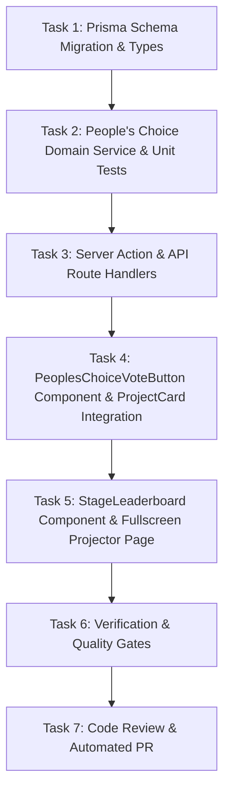

# Implementation Tasks: Demo Day People's Choice Voting & Stage Leaderboard

**Feature ID**: `046-peoples-choice-voting-stage-leaderboard`  
**Ticket**: [VS-116](https://the-three-devsketeers.atlassian.net/browse/VS-116)  
**Parent Epic**: [VS-82](https://the-three-devsketeers.atlassian.net/browse/VS-82)  
**Status**: Ready for Implementation  

---

## Task Matrix & Dependency Order

---

### Phase 1: Database & Domain Service

#### Task 1: Prisma Schema Migration & Domain Types
- [x] Update `prisma/schema.prisma` with `model ProjectVote` and relation fields on `ProjectSubmission` and `Event`.
- [x] Add `voteCount Int @default(0)` to `ProjectSubmission`.
- [x] Run migration using `db-migrate` workflow and regenerate Prisma client.
- [x] Create `src/features/hackathons/types/peoples-choice.ts`.
- [x] Atomic Commit: `feat(db): add project vote model and cached vote count`

#### Task 2: People's Choice Domain Service & Unit Tests
- [x] Write unit tests in `tests/unit/hackathons/peoples-choice-service.test.ts` verifying:
  - Atomic vote casting and `voteCount` increment.
  - Rejection with `"You have already cast your People's Choice vote for this hackathon."` on duplicate vote.
  - Rate limiting / operational event status checks.
  - Leaderboard data retrieval with rank calculations and percentage shares.
- [x] Implement `src/features/hackathons/services/peoples-choice-service.ts`.
- [x] Run test: `npx vitest run tests/unit/hackathons/peoples-choice-service.test.ts`.
- [x] Atomic Commit: `feat(hackathons): implement peoples choice domain service and ranking calculations`

---

### Phase 2: Actions, APIs & Interactive Components

#### Task 3: Server Action & Route Handlers
- [x] Implement `src/features/hackathons/actions/cast-peoples-choice-vote.ts`.
- [x] Implement `src/app/api/events/[slug]/peoples-choice/route.ts` for casting vote and checking voter status.
- [x] Implement `src/app/api/events/[slug]/stage-leaderboard/route.ts` for stage display polling.
- [x] Write unit tests in `tests/unit/hackathons/cast-peoples-choice-vote-action.test.ts`.
- [x] Atomic Commit: `feat(hackathons): implement peoples choice server action and api routes`

#### Task 4: PeoplesChoiceVoteButton Component & ProjectCard Integration
- [x] Write unit tests in `tests/unit/hackathons/peoples-choice-vote-button.test.tsx` verifying:
  - Unvoted state `"Vote People's Choice"`.
  - Transitions to active state `"Voted"` with credit decrement upon click.
  - Duplicate vote triggers accessible toast `"You have already cast your People's Choice vote for this hackathon."`.
  - Zero-radius styling and dual-theme contrast.
- [x] Implement `src/features/hackathons/components/peoples-choice-vote-button.tsx`.
- [x] Integrate button into `src/features/hackathons/components/project-card.tsx`.
- [x] Run test: `npx vitest run tests/unit/hackathons/peoples-choice-vote-button.test.tsx`.
- [x] Atomic Commit: `feat(hackathons): implement peoples choice vote button and project card integration`

---

### Phase 3: Stage Display & Fullscreen Kiosk Mode

#### Task 5: StageLeaderboard Component & Fullscreen Projector Route
- [x] Write unit tests in `tests/unit/hackathons/stage-leaderboard.test.tsx` verifying:
  - Renders top project rankings, vote tallies, percentage bars, and podium badges.
  - Fullscreen toggle via `F` key and button click.
  - Track filter pills updating displayed standings.
  - Dual-theme contrast (Light mode Opal `#F8FAFC`, Dark mode `#0d1424`).
- [x] Implement `src/features/hackathons/components/stage-leaderboard.tsx`.
- [x] Implement `src/app/(public)/events/[slug]/stage/page.tsx` with:
  - Awaited params `const { slug } = await props.params`.
  - Guard redirect/fallback for non-hackathon archetypes.
  - Suspense fallback boundary.
- [x] Run test: `npx vitest run tests/unit/hackathons/stage-leaderboard.test.tsx`.
- [x] Atomic Commit: `feat(hackathons): implement stage leaderboard and fullscreen projector route`

---

### Phase 4: Verification, Review & Delivery

#### Task 6: Verification & Quality Gates
- [ ] Run `npm run typecheck` (zero TypeScript errors).
- [ ] Run `npm run lint` (zero ESLint warnings/errors).
- [ ] Run `npm run test:unit` (100% green tests).
- [ ] Run `constitution-check` to verify principles §I–§VI.
- [ ] Run `graphify-auto-sync` (`graphify . --update`) to sync AST.

#### Task 7: Two-Axis Code Review & Automated PR
- [ ] Run parallel `code-review` (Spec Axis & Standards Axis).
- [ ] Run `code-review-and-quality` (5 Quality Dimensions).
- [ ] Trigger `pr-creator` inside the worktree to rebase, push, and open PR targeting `main`.
- [ ] Post completion comment and PR link to Jira ticket `VS-116` via Atlassian MCP.
