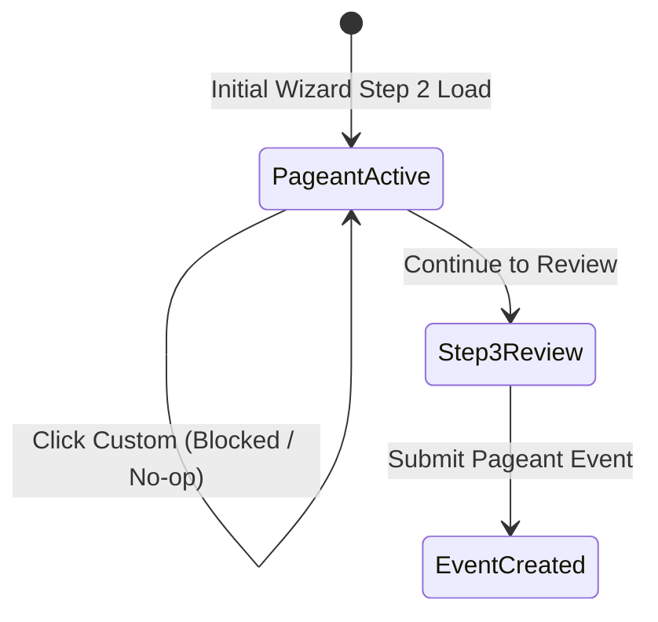

# Data Model & Interfaces: Disable Non-Pageant Archetypes

**Feature ID**: `047-disable-non-pageant-archetypes`  
**Jira Key**: `VS-117`  
**Date**: 2026-10-17  

---

## 1. Types & Enums (`src/features/events/types/archetype.ts`)

```typescript
export const EVENT_ARCHETYPES = [
  "PAGEANT",
  "STUDENT_COUNCIL",
  "HACKATHON",
  "CUSTOM",
] as const;

export type EventArchetype = (typeof EVENT_ARCHETYPES)[number];

export const ACTIVE_ARCHETYPES = ["PAGEANT"] as const;
export type ActiveEventArchetype = (typeof ACTIVE_ARCHETYPES)[number];

export const COMING_SOON_ARCHETYPES = [
  "STUDENT_COUNCIL",
  "HACKATHON",
  "CUSTOM",
] as const;
export type ComingSoonEventArchetype = (typeof COMING_SOON_ARCHETYPES)[number];

export interface ArchetypeConfig {
  id: EventArchetype;
  label: string;
  description: string;
  groupingTerm: string;
  candidateTerm: string;
  allowMultipleSelections: boolean;
  defaultMaxSelections: number;
  isComingSoon?: boolean;
}

export function isArchetypeAvailable(archetype: EventArchetype): boolean {
  return archetype === "PAGEANT";
}

export function isArchetypeComingSoon(archetype: EventArchetype): boolean {
  return archetype !== "PAGEANT";
}
```

---

## 2. Component Props Interface (`src/features/events/components/archetype-selector.tsx`)

```typescript
export interface ArchetypeSelectorProps {
  value: EventArchetype;
  onChange: (value: EventArchetype) => void;
  disabled?: boolean;
  className?: string;
}
```

---

## 3. Boundary Schema Contracts

### `src/lib/validations/event.ts`
```typescript
export const createEventSchema = z.object({
  title: z.string().trim().min(3).max(120),
  slug: eventSlugSchema,
  description: z.string().trim().min(10).max(5000),
  bannerUrl: z.string().url(),
  startsAt: z.string().datetime(),
  endsAt: z.string().datetime(),
  archetype: z
    .enum(EVENT_ARCHETYPES)
    .default("PAGEANT")
    .refine(
      (val) => isArchetypeAvailable(val),
      {
        message: "This event archetype is coming soon and currently disabled.",
      }
    ),
  positions: z.array(wizardPositionDraftSchema).optional(),
  divisions: z.array(wizardDivisionDraftSchema).optional(),
  awardCategories: z.array(wizardAwardDraftSchema).optional(),
});
```

---

## 4. State Transition Diagram


