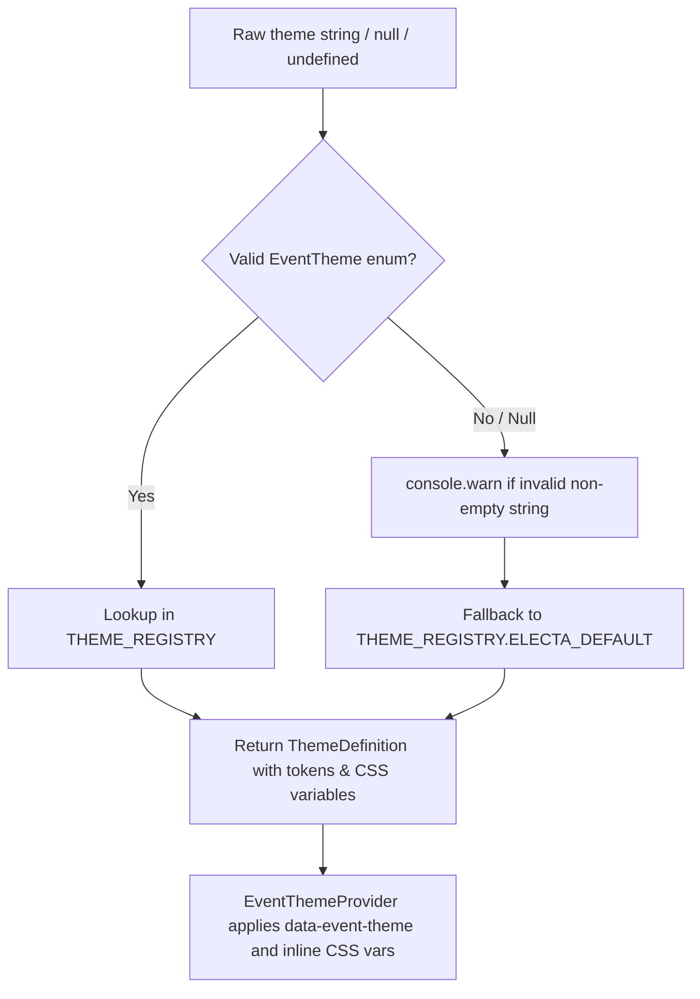

# Data Model & Theme Resolution Specification

**Feature ID**: `048-dynamic-theme-resolution-engine`  
**Ticket**: [VS-120](https://the-three-devsketeers.atlassian.net/browse/VS-120)  
**Parent Epic**: [VS-119](https://the-three-devsketeers.atlassian.net/browse/VS-119)  
**Status**: Completed  
**Date**: 2026-10-22  

---

## 1. Prisma Database Schema

```prisma
enum EventTheme {
  ELECTA_DEFAULT
  PAGEANT_EDITORIAL
}

model Event {
  id                  String                 @id @default(uuid())
  slug                String                 @unique
  title               String
  description         String
  bannerUrl           String
  startsAt            DateTime
  endsAt              DateTime
  publicationStatus   EventPublicationStatus @default(DRAFT)
  draftPassphraseHash String?
  showResultsOnClose  Boolean                @default(true)
  isFreeVotingEnabled Boolean                @default(true)
  isFreeVotingOnly    Boolean                @default(false)
  dailyFreeVoteLimit  Int                    @default(1)
  takeRatePercentage  Decimal                @default(12.00) @db.Decimal(5, 2)
  organizerId         String
  archetype           EventArchetype         @default(PAGEANT)
  theme               EventTheme             @default(ELECTA_DEFAULT)
  allowedEmailDomains String[]               @default([])
  createdAt           DateTime               @default(now())
  updatedAt           DateTime               @updatedAt
  ...
}
```

---

## 2. TypeScript Domain Interfaces

```ts
// src/features/events/types/theme.ts

export const EVENT_THEMES = ["ELECTA_DEFAULT", "PAGEANT_EDITORIAL"] as const;
export type EventTheme = (typeof EVENT_THEMES)[number];

export interface ThemeTokens {
  bgBase: string;
  bgSurface: string;
  bgSurfaceElevated: string;
  bgSurfaceHover: string;
  borderHairline: string;
  borderAccent: string;
  accentPrimary: string;
  accentSecondary: string;
  accentMuted: string;
  textPrimary: string;
  textSecondary: string;
  textTertiary: string;
  fontHeading: string;
  fontBody: string;
  fontSerif?: string;
  radiusSm: string;
  radiusMd: string;
  radiusLg: string;
  radiusPill: string;
}

export interface ThemeDefinition {
  id: EventTheme;
  slug: string;
  displayName: string;
  description: string;
  tokens: ThemeTokens;
  cssVariables: Record<string, string>;
}
```

---

## 3. Theme Resolution Engine Flow



---

## 4. DTO Extension

```ts
// src/features/events/types/index.ts
export interface PublicEventDto {
  ...
  theme?: EventTheme;
}
```
