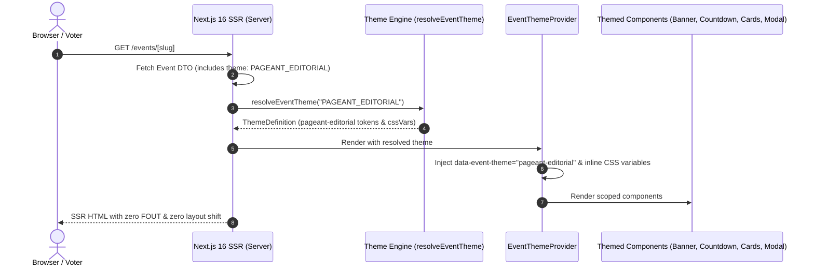

# Data Model: Haute-Couture Pageant Editorial Theme

**Feature ID**: `049-pageant-editorial-theme`  
**Ticket**: [VS-121](https://the-three-devsketeers.atlassian.net/browse/VS-121)  
**Parent Epic**: [VS-119](https://the-three-devsketeers.atlassian.net/browse/VS-119)  
**Date**: 2026-10-23  

---

## 1. Entity Models & DTOs

### Event Entity Theme Field
The `Event` model in `prisma/schema.prisma` stores the selected theme:
```prisma
enum EventTheme {
  ELECTA_DEFAULT
  PAGEANT_EDITORIAL
}

model Event {
  id        String     @id @default(uuid())
  title     String
  slug      String     @unique
  theme     EventTheme @default(ELECTA_DEFAULT)
  // ... other event fields
}
```

### PublicEventDto
Extended in `src/features/events/types/index.ts`:
```typescript
export interface PublicEventDto {
  id: string;
  slug: string;
  title: string;
  description: string | null;
  bannerUrl: string;
  startsAt: string;
  endsAt: string;
  operationalState: EventOperationalState;
  theme: EventTheme;
  // ... relations
}
```

### Theme Tokens Representation (`ThemeTokens`)
Defines the visual design tokens populated for `PAGEANT_EDITORIAL`:
```typescript
export interface ThemeTokens {
  bgBase: string;              // "#0B0C10"
  bgSurface: string;           // "#12141C"
  bgSurfaceElevated: string;   // "#181B26"
  bgSurfaceHover: string;      // "#1E2230"
  borderHairline: string;      // "rgba(255, 255, 255, 0.08)"
  borderAccent: string;        // "rgba(203, 178, 121, 0.35)"
  borderAccentBright: string;  // "#CBB279"
  accentPrimary: string;       // "#CBB279"
  accentSecondary: string;     // "#F4EBD9"
  accentMuted: string;         // "#8E7C55"
  textPrimary: string;         // "#F9F9FB"
  textSecondary: string;       // "#9BA3B4"
  textTertiary: string;        // "#5D6577"
  fontHeading: string;         // "'Cormorant Garamond', Georgia, serif"
  fontBody: string;            // "'Plus Jakarta Sans', -apple-system, BlinkMacSystemFont, sans-serif"
  fontSerif?: string;          // "'Cormorant Garamond', Georgia, serif"
  radiusSm: string;            // "4px"
  radiusMd: string;            // "8px"
  radiusLg: string;            // "14px"
  radiusPill: string;          // "9999px"
}
```

### Theme Definition (`ThemeDefinition`)
```typescript
export interface ThemeDefinition {
  id: EventTheme;
  slug: string; // "pageant-editorial"
  displayName: string; // "Pageant Editorial Haute-Couture"
  description: string;
  tokens: ThemeTokens;
  cssVariables: Record<string, string>;
}
```

---

## 2. State & Data Flow


